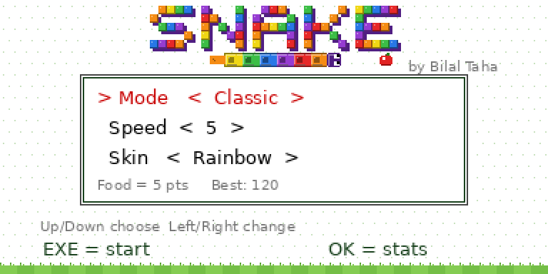
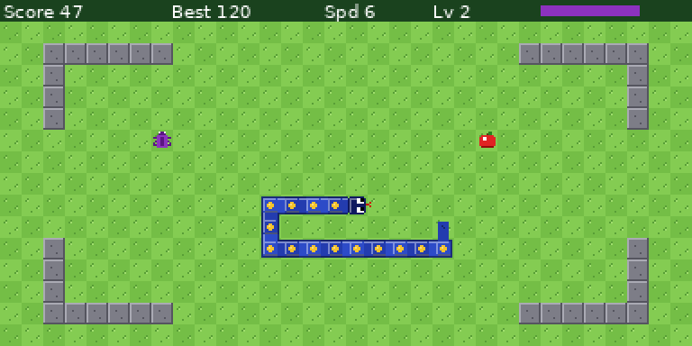
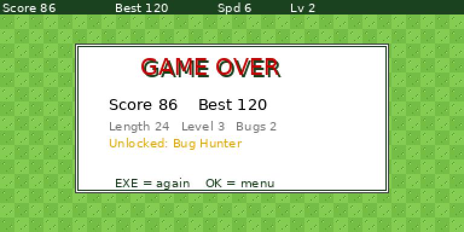
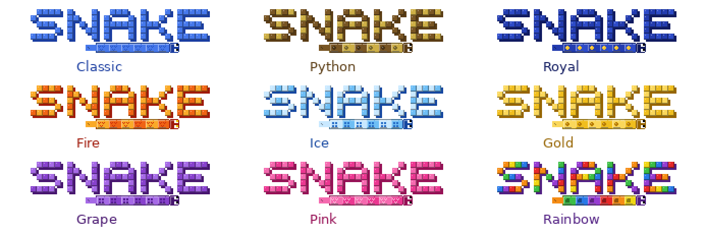

# 🐍 Snake for the Casio fx-CG100

**A Nokia *Snake II*-style game for the Casio fx-CG100 (ClassWiz CG) graphing calculator, made by Bilal Taha.**

It's written in MicroPython with Casio's built-in `casioplot` module, so it runs on a **normal, unmodified calculator**. No jailbreak, add-ins or MPM needed.



| Gameplay | Game over |
|---|---|
|  |  |



*Screenshots are from the PC simulator, so the font differs slightly from the real calculator.*

---

## ✨ Features

- **3 modes:** Classic (walls kill you), Wrap (leave one edge, come back on the other) and Maze (4 wall layouts that change as you level up)
- **Nokia-style scoring:** every apple is worth your current speed, from 1 to 9 points
- **Levels:** every 10 apples the snake speeds up and apples are worth more
- **Bonus bug:** appears every 5 apples. The faster you catch it, the more it's worth, and if you miss one the next is worth more
- **9 skins:** Classic, Python, Royal, Fire, Ice, Gold, Grape, Pink and Rainbow, each with its own pattern. The SNAKE logo changes colour to match
- **Textured grass field**, flicking tongue, pulsing apples, wiggling bugs
- **Death animation:** the head flashes, the body bursts and a little ghost floats away
- **8 achievements** and a stats screen

## 📥 Install

1. Download the two files from the [`calculator`](calculator) folder:
   - `snake14.py`: the game
   - `sgfx14.py`: graphics and skins
2. Connect the calculator to your computer with a USB cable and choose **USB Flash** on the calculator.
3. Copy **both** files to the **top level** of the calculator drive, not into a folder.
4. Eject the drive on your computer, wait for **"Complete!"** on the calculator, press **OK**, then unplug.
5. On the calculator, go to **HOME → Python → TOOLS → File → Open**, pick **`snake14.py`** and run it.

## 🎮 Controls

| Key | Action |
|---|---|
| Arrow keys | Move (8 / 2 / 4 / 6 also work) |
| EXE | Start / play again |
| OK | Pause in game, stats screen from the menu |
| AC | Quit |

On the title screen, use **Up/Down** to choose Mode, Speed or Skin, and **Left/Right** to change it.

## ✅ Compatibility

| Calculator | Status |
|---|---|
| Casio fx-CG100 (OS 2.10) | ✅ Tested |
| Casio Graph Math+ / fx-1AU GRAPH | Should work, not tested |
| Casio fx-CG50 / Graph 90+E | ❌ Its Python has no `getkey()` |

Stats, best scores and achievements reset when you quit the game or turn the calculator off, because the calculator's Python can't save files.

## 💻 Test it on a PC (optional)

The [`pc-simulator`](pc-simulator) folder has `casioplot.py`, a PC version of the calculator's graphics module, so you can try the game without a calculator.

```bash
# Ubuntu / Debian (once)
sudo apt install python3-tk python3-pil

# run it
cd calculator
PYTHONPATH=../pc-simulator python3 snake14.py
```

On Windows or Mac, install Python and `pip install pillow`, then copy `casioplot.py` into the `calculator` folder and run `python snake14.py`.

PC keys: arrows = arrows, Enter = EXE, Space or O = OK, Esc = quit.

> ⚠️ **Never copy `casioplot.py` to the calculator.** It would replace the real module and break Python graphics on it.

## ⚙️ Tuning

If every speed feels too fast or too slow on your calculator, change `DELAY=2500` near the top of `snake14.py`. A higher number makes the game slower.

## 📝 Versions

Calculator file names can't contain dots, so the version is in the name: `snake14.py` + `sgfx14.py` = **v1.4**. To update, delete the old pair from the calculator and copy the new pair.

## 📄 License

[MIT](LICENSE) © 2026 Bilal Taha. You're free to use, change and share it, as long as you keep the copyright notice.

Made by **Bilal Taha** ([@Onepieceman123](https://github.com/Onepieceman123))
